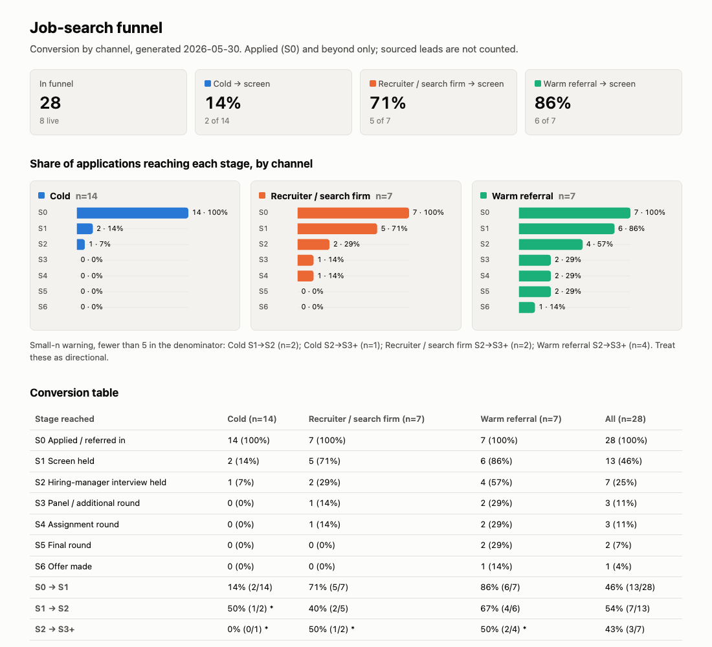

# job-search-funnel

**RevOps funnel discipline, applied to your own job search.**

A Claude Code skill pack, plus a small stdlib Python CLI. It rebuilds a backlogged job pipeline from your own
Gmail and Calendar (read-only, official connectors), culls what's dead, classifies every real attempt by
**channel** (cold / recruiter / warm referral) and **stage** (S0 applied → S6 offer), and gives you a
conversion funnel by source. Each live opportunity gets its next action.

It answers the question most trackers can't: *which of my channels actually turns into conversations?*



## Who it's for

People running a real search, with dozens of applications, recruiter threads, and referrals, who:
- have lost track, and whose inbox holds the true record;
- want to know where their effort converts, not just a list of what they applied to;
- are comfortable running Claude Code and a Python script.

If you have five applications open, you don't need this. A spreadsheet is fine.

## What's in the box

| Path | What it is |
|---|---|
| `skills/funnel-backfill` | One-time catch-up: sweep N months of mail and calendar, propose stage + channel with evidence, ask batched questions, write the funnel. |
| `skills/funnel-review` | Daily or weekly incremental pass: reconcile changes since the last review, surface due actions, report cadence. |
| `skills/backlog-cull` | Find stale items, propose close / nudge / keep, apply your decisions. Never asks the same question twice. |
| `skills/source-screen` | Screen new leads against your own filter spec, starting with your exclusion list. |
| `tools/funnel.py` | The deterministic layer: store, stage rules, `report`, `stale`, `validate`, `render` (Markdown + self-contained HTML dashboard). |
| `config/` | `filter-spec.example.yaml` and a fully synthetic `funnel.example.json` (31 records at made-up companies: 28 in the funnel + 3 sourced leads). |
| `hooks/` | Optional SessionStart hook that prints "funnel review due". |
| `docs/STAGES.md` | The taxonomy: stages, channels, outcomes, confidence, the Passed-vs-removed rule. |
| `docs/AGENTIC.md` | The strict definition of "agentic" these skills meet, and where the human gates are. |

## Quickstart

```sh
git clone https://github.com/drewnoel/job-search-funnel ~/job-search-funnel
export FUNNEL_HOME=~/job-search-funnel          # add to your shell profile

# See it work on the synthetic sample (no setup, no connectors):
python3 $FUNNEL_HOME/tools/funnel.py --store $FUNNEL_HOME/config/funnel.example.json report
python3 $FUNNEL_HOME/tools/funnel.py --store $FUNNEL_HOME/config/funnel.example.json --today 2026-05-30 render --out /tmp/funnel-demo
open /tmp/funnel-demo/funnel.html

# Install the skills (symlinks, so `git pull` updates them):
mkdir -p ~/.claude/skills
for s in "$FUNNEL_HOME"/skills/*; do ln -s "$s" ~/.claude/skills/; done
```

Then connect **Gmail** and **Google Calendar** in Claude Code (claude.ai connectors or any official MCP server
for them). The skills only use search/read tools. If your setup allows it, restrict the connectors to read
tools in your permission settings too, so the guarantee doesn't depend on the prompt.

Requirements: Python 3.9+ (stdlib only), Claude Code, and Gmail + Calendar connectors. No pip installs.

## 10-minute onboarding

1. **(1 min) Copy the spec.** `cp config/filter-spec.example.yaml config/filter-spec.yaml`. Edit the
   exclusion list, seat titles, and comp floors. All of it is optional except what you care about.
2. **(1 min) Read the taxonomy.** Skim `docs/STAGES.md`. The two rules that matter: *scheduled is not held*,
   and *channel = how you entered*.
3. **(5 min) Backfill.** In Claude Code: "Run funnel-backfill for the last 6 months." It will sweep, then ask
   you one or two batches of lettered questions ("1y 2n 3w ..."). Answer them. Each batch is built to be answered
   in about 30 seconds.
4. **(1 min) Look at it.** `python3 tools/funnel.py report`, and open `data/funnel.html`.
5. **(2 min) Cull.** "Run backlog-cull with 21 days." Decide close / nudge / keep for anything stale.
6. **(optional) Wire the hook** (below) so every session reminds you when the daily review hasn't run.

Your real data lives in `data/` (git-ignored). Nothing leaves your machine except what the connectors read
into your Claude session.

## The CLI

```sh
F="python3 $FUNNEL_HOME/tools/funnel.py"      # store defaults to $FUNNEL_HOME/data/funnel.json
$F add --company "Acme Robotics" --role "Head of RevOps" --channel cold \
       --evidence "ATS ack email, 'Thanks for applying'" --date 2026-03-03
$F stage acme-robotics-head-of-revops S1 --evidence "Calendar: recruiter screen held" --date 2026-03-19
$F update acme-robotics-head-of-revops --set next_action="Send work sample" --set next_action_due=2026-03-21
$F report            # conversion by channel, small-n flagged, reconciliation line
$F stale --days 14   # active items with no motion
$F due --horizon 7   # next actions due this week
$F validate          # evidence per stage, duplicates, legal stage order, reconciled counts (exit 1 on error)
$F render            # data/funnel.md + data/funnel.html (inline SVG, light + dark, no network)
$F remove <id> --why "screened out: comp"   # never-real attempts only; logged so they don't come back
$F answer --key "<id>:close-stalled" --question "..." --answer "keep:2026-06-20"
$F answers --key "<id>:close-stalled"        # exit 3 if never asked
$F stamp             # mark today's review done (read by the hook)
```

The store can be JSON (recommended) or CSV (`--store data/funnel.csv`). A CSV store holds one row per opportunity (the `evidence` column is a JSON array) and keeps its removed log and
answers log in a `funnel.log.json` sidecar next to it, since a flat sheet can't hold them.

Tests: `python3 -m unittest discover -s tests -v`

## Hook

`hooks/funnel-review-due.sh` prints `funnel review due: last review YYYY-MM-DD` at session start when today's
review hasn't run, and stays silent otherwise. Add to `~/.claude/settings.json`:

```json
{
  "hooks": {
    "SessionStart": [
      {
        "hooks": [
          { "type": "command", "command": "FUNNEL_HOME=$HOME/job-search-funnel $HOME/job-search-funnel/hooks/funnel-review-due.sh" }
        ]
      }
    ]
  }
}
```

Merge it into any existing `hooks` block instead of replacing the block.

## Where this fits (honestly)

Job trackers like Huntr, Teal, and Simplify are good at what they do: capturing applications as you make
them (browser extensions, autofill), Kanban boards, notes, and contacts. If you start using one on day one and
log every step, you may not need this.

This pack covers two gaps we haven't seen those tools cover well, as of this writing:
- **Rebuilding a backlog from the record.** If you're 40 applications in and the tracker is stale, the skills
  reconstruct the pipeline from your email and calendar, with a cited source for every stage.
- **Conversion by source.** Splitting results by cold / recruiter / warm, with stage-to-stage rates and
  small-n warnings, is how a RevOps team would read a funnel. It tells you where to put next week's hours.

It is not a tracker replacement. There is no mobile app, no browser extension, no autofill, and no
job-board search. You can run both: export from your tracker to CSV and let `funnel-backfill` merge it.

## Limitations

- **Small samples.** Most searches produce tens of opportunities, not thousands. Rates move a lot on one
  result. The report flags denominators under 5; treat everything as directional.
- **Evidence lives where you looked.** Conversations that happened on LinkedIn messages, phone, or text
  won't be found unless they left a trace in mail or calendar. The skills ask instead of guessing, but they
  can only ask about what they can see.
- **Classification is a model's judgment** with a deterministic check behind it. Ambiguous cases go to you;
  clear ones are applied automatically. Review the first backfill.
- **Connector reach.** Built for Gmail + Google Calendar. Other mail and calendar providers work if you have an
  official MCP connector for them, or via an export, but the search queries in the skills are Gmail syntax.
- **No scraping, by design.** Company size, stage, or posting age that isn't in your mail or an official
  connector stays `unknown` until you supply it.
- **No outbound automation.** It will write follow-up text for you; it won't send it unless you say so for that item.

## Privacy

- Connectors are used read-only. Your funnel data stays in `data/` on your machine and is git-ignored.
- `config/funnel.example.json` is fully synthetic: every company, role, and event is invented.

## License

MIT. See `LICENSE`.

Built by Drew Noel.
